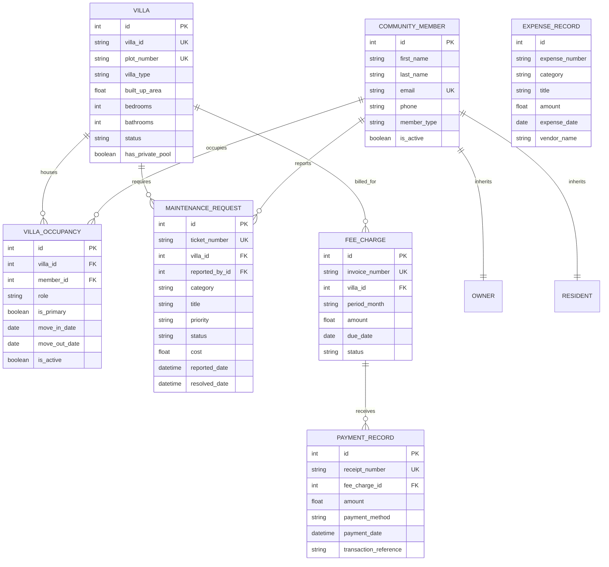

# VillaVerse — Premium Villa Community Management Platform

[](https://www.python.org/)
[](https://flask.palletsprojects.com/)
[](https://www.sqlalchemy.org/)
[](tests/)
[](app/)

> **VillaVerse** is a modern, modular, production-ready villa community management platform designed for gated private estates managing 100 to thousands of individual villas. Built with **Python 3**, **Flask**, **SQLAlchemy ORM**, **SQLite**, **Bootstrap 5**, and **Chart.js**, it demonstrates clean Object-Oriented Programming (OOP) principles, defensive domain modeling, transactional integrity, and SaaS visual aesthetics.

---

## 1. Project Overview & Problem Statement

Managing a high-end gated villa community involves complex real-time operational workflows:
- Tracking individual plot cadastre numbers, built-up areas, architectural typologies, and occupancy states (*Available*, *Occupied*, *Under Construction*).
- Differentiating between **legal property owners** (with AGM voting rights, title deeds) and **resident tenants** (with lease agreements, primary contact flags).
- Enforcing service-level agreements (SLAs) on critical infrastructure repairs across plumbing, HVAC, electrical, landscaping, and private pools.
- Calculating monthly community maintenance dues based on villa square footage, tracking partial/full collections, and reconciling community operational expenditures.
- Generating live analytical dashboards and audit-ready CSV exports.

**VillaVerse** solves this by centralizing these workflows into an intuitive, role-aware, and transactional web application.

---

## 2. Key Features by Module

### 🏛️ Module A: Villa Management
- **Registration & Validation**: Register unique Villa IDs (`V-101`) and Plot Numbers (`PL-101`) with automatic duplicate rejection.
- **Architectural Specs**: Track built-up area (sq. ft.), converted metric area ($m^2$), bedrooms, bathrooms, stories, private pool availability, and manicured garden area.
- **Encapsulated State Machine**: Strict status transitions (*Available* &harr; *Occupied* &harr; *Under Construction*). Prevents invalid operations such as direct occupation of villas currently under construction.
- **Search, Filter & Pagination**: Server-side query filtering by search terms, status, and architectural type, complete with pagination.

### 👥 Module B: Residents & Owners
- **OOP Inheritance & Polymorphism**: Base `CommunityMember` class inherited by specialized `Owner` and `Resident` subclasses.
- **AGM Voting & Permissions**: Polymorphic methods grant legal owners voting rights in community resolutions while designating tenants as non-voting lessees.
- **Historical Occupancy Tracking**: Links occupants to villas via `VillaOccupancy`. Vacating or transferring an occupant preserves move-in/move-out historical records while automatically resetting empty villas to *Available*.

### 🔧 Module C: Maintenance Operations
- **Lifecycle Tracking**: Ticket creation (`REQ-YYYYMM-XXXX`) through *Open*, *In Progress*, and *Resolved* states.
- **SLA & Overdue Engine**: Automatic calculation of SLA breaches (Urgent tickets > 24h, High > 48h, Standard > 5 days).
- **Resolution Certification**: Mandatory resolution notes, contractor assignment, and repair cost accounting.

### 💰 Module D: Community Dues & Expenses
- **Dynamic Fee Billing**: Automated batch generation of monthly maintenance assessments proportional to villa square footage (`sq.ft * base_rate`).
- **Payment Ledger**: Real-time balance calculations, partial payment applications, receipt number generation, and overpayment prevention.
- **Operational Expenditures**: Separate accounting ledger for community infrastructure expenses (security patrols, central pool chlorination, common lighting, landscaping).

### 📊 Module E: Community Analytics & CSV Reports
- **Executive Dashboard**: Real-time KPI summary cards backed by live database queries.
- **Interactive Visualizations**: Chart.js donut chart for occupancy distribution, monthly cashflow bar charts (invoiced vs. collected vs. spent), and maintenance category volume.
- **One-Click CSV Export**: Download complete, formatted datasets for Villas Registry, Maintenance Work Orders, and Financial Ledgers.

---

## 3. Technology Stack

| Layer | Technology | Purpose |
|---|---|---|
| **Language** | Python 3.14+ | Object-Oriented core logic, service layer, and data modeling |
| **Backend Framework** | Flask 3.1 | Application factory, blueprints, and routing |
| **Database & ORM** | SQLite 3 & SQLAlchemy 2.1 | Relational database with Foreign Keys, indexes, and transactions |
| **Form & Security** | Flask-WTF 1.3 & WTForms | Server-side validation and CSRF token protection |
| **Frontend Framework** | Bootstrap 5.3 & Vanilla CSS | Modern responsive SaaS layout, custom design system |
| **Visualizations** | Chart.js 4.4 | Database-driven responsive charts |
| **Testing** | pytest 9.2 & Flask Test Client | 30 unit, service, integration, and route test cases |

---

## 4. Visual Design System

VillaVerse avoids generic template designs and adopts an elegant, contemporary private real-estate aesthetic:
- **Primary Color**: Deep Forest Green (`#0F382C`, `#164E3D`) representing security, prestige, and estate grounds.
- **Accent Color**: Restrained Gold (`#C59B27`) for highlights, owner badges, and important actions.
- **Background**: Soft Warm Off-White (`#F8F9FA`) with pristine white surface cards (`#FFFFFF`).
- **Typography**: Plus Jakarta Sans for crisp UI hierarchy and readability.
- **UI Components**: Fixed modern sidebar, responsive mobile offcanvas, status pills, hover elevations, and dismissal alerts.

---

## 5. Architecture & Code Organization

VillaVerse adheres to a **Clean Layered Architecture**, strictly separating concerns:

```text
VillaVerse/
├── app/
│   ├── __init__.py               # Application factory, filters, CLI commands
│   ├── exceptions.py             # Custom domain exception hierarchy
│   ├── extensions.py             # SQLAlchemy & CSRF instances
│   ├── models/                   # Domain Entities & SQLAlchemy Mappings
│   │   ├── base.py               # Abstract BaseModel with audit timestamps
│   │   ├── villa.py              # Villa model (Encapsulation, State FSM)
│   │   ├── member.py             # CommunityMember, Owner, Resident (Inheritance)
│   │   ├── occupancy.py          # VillaOccupancy association model
│   │   ├── maintenance.py        # MaintenanceRequest entity & SLA logic
│   │   └── finance.py            # FeeCharge, PaymentRecord, ExpenseRecord
│   ├── services/                 # Business Logic & Orchestration Layer
│   │   ├── base.py               # Abstract BaseService (Abstraction)
│   │   ├── villa_service.py      # Villa CRUD, search, filter, stats
│   │   ├── resident_service.py   # Occupancy, transfers, vacancies
│   │   ├── maintenance_service.py# Work orders, SLA inspection, resolution
│   │   ├── finance_service.py    # Dues generation, payment application
│   │   └── report_service.py     # Aggregation, Chart.js feeds, CSV exports
│   ├── forms/                    # WTForms with CSRF & Field Validations
│   │   ├── villa_forms.py
│   │   ├── member_forms.py
│   │   ├── maintenance_forms.py
│   │   └── finance_forms.py
│   ├── routes/                   # Flask Blueprints (HTTP Controllers)
│   │   ├── dashboard.py          # Overview metrics & Chart API
│   │   ├── villas.py             # Villa catalog, detail, add, edit
│   │   ├── residents.py          # Owners & tenants directory
│   │   ├── maintenance.py        # Work orders & technician assignment
│   │   ├── finance.py            # Invoicing, payments, and expenses
│   │   └── reports.py            # Analytics & CSV downloads
│   ├── static/                   # Assets (CSS & JS)
│   │   ├── css/style.css         # Custom SaaS design tokens
│   │   └── js/
│   │       ├── main.js           # UI toggles, table filters
│   │       └── dashboard.js      # Chart.js initialization
│   └── templates/                # Jinja2 Layouts & Pages
├── tests/                        # Automated Pytest Suite
│   ├── conftest.py               # Fixtures & in-memory test database
│   ├── test_models.py            # OOP encapsulation & domain rules
│   ├── test_services.py          # Service orchestration tests
│   └── test_routes.py            # Integration & CSV export tests
├── instance/                     # SQLite database file
├── config.py                     # Development, Testing, Production configs
├── seed.py                       # Idempotent seed script (105 villas, 95 members)
├── run.py                        # Application entry point
├── requirements.txt              # Dependency specifications
├── pytest.ini                    # Pytest configuration
├── .env.example                  # Environment variable reference
└── README.md                     # Documentation
```

---

## 6. Database Entity Relationship Diagram



---

## 7. Python OOP Concepts Demonstrated

This project was architected to showcase clean, defensible Object-Oriented Programming:

| OOP Concept | Implementation Location | Concrete Example in VillaVerse |
|---|---|---|
| **Classes & Objects** | [`app/models/villa.py`](app/models/villa.py) | `Villa`, `CommunityMember`, `FeeCharge`, and `MaintenanceRequest` encapsulate state and behavior. |
| **Encapsulation** | [`app/models/villa.py`](app/models/villa.py#L88-L109), [`app/models/finance.py`](app/models/finance.py#L42-L75) | `Villa.change_status()` enforces state machine transitions. `FeeCharge.record_payment()` calculates remaining balance, prevents overpayment, and auto-updates status. |
| **Inheritance** | [`app/models/member.py`](app/models/member.py#L70-L125) | `CommunityMember` serves as the base class for `Owner` and `Resident`, sharing base contact validation while specializing domain attributes. |
| **Polymorphism** | [`app/models/member.py`](app/models/member.py#L55-L65) | `Owner` and `Resident` override `get_role_label()`, `get_badge_class()`, `can_vote_in_agm()`, and `format_summary()`. Jinja templates invoke these methods uniformly without type checking. |
| **Abstraction** | [`app/services/base.py`](app/services/base.py) | `BaseService[T]` is an Abstract Base Class (ABC) using `@abstractmethod` to enforce `get_by_id()` and `list_all()`. |
| **Composition** | [`app/models/villa.py`](app/models/villa.py#L48-L70) | A `Villa` contains and manages collections of `VillaOccupancy`, `MaintenanceRequest`, and `FeeCharge` instances. |
| **Properties & Setters** | [`app/models/villa.py`](app/models/villa.py#L111-L128) | `@property area_sqm` provides on-the-fly metric conversion; `@property outstanding_balance` dynamically aggregates unpaid charges. |
| **Class Attributes & Methods** | [`app/models/villa.py`](app/models/villa.py#L18-L34) | `Villa.ALLOWED_STATUSES`, `Villa.VILLA_TYPES`, and the factory class method `Villa.create_villa()`. |
| **Domain Exception Hierarchy** | [`app/exceptions.py`](app/exceptions.py) | Custom exceptions (`DuplicatePlotError`, `InvalidStatusTransitionError`, `InvalidPaymentError`) inheriting from `VillaVerseError`. |
| **Separation of Concerns** | `app/routes/` vs `app/services/` vs `app/models/` | Route handlers only handle HTTP parsing/redirects; Service classes execute domain rules and orchestrate DB transactions; Models store entities and invariant logic. |

---

## 8. Quick Setup Guide (Windows PowerShell)

Follow these steps to run VillaVerse from scratch on Windows:

### 1. Clone or Open Workspace
```powershell
cd c:\Users\aksha\OneDrive\Desktop\Villa-Verse
```

### 2. Create and Activate Virtual Environment
```powershell
python -m venv .venv
.\.venv\Scripts\Activate.ps1
```

### 3. Install Dependencies
```powershell
pip install -r requirements.txt
```

### 4. Populate Database with 100+ Fictional Records
```powershell
python seed.py
```
*(This creates 105 realistic villas, 95 owners/tenants, 45 maintenance tickets, and 3 months of dues ledgers).*

### 5. Run the Automated Test Suite
```powershell
pytest -v
```

### 6. Launch the Local Development Server
```powershell
python run.py
```
Open **[http://127.0.0.1:5000](http://127.0.0.1:5000)** in your browser.

---

## Render Deployment

VillaVerse's WSGI entry point is `run.py`, which exports the Flask application as `app`. Configure a Render **Web Service** with:

- **Build command:** `pip install -r requirements.txt`
- **Start command:** `flask --app run:app init-db && exec gunicorn --bind 0.0.0.0:$PORT run:app`
- **Runtime:** Python 3.11 or newer

Set these Render environment variables:

| Variable | Required | Value |
|---|---|---|
| `FLASK_ENV` | Yes | `production` |
| `SECRET_KEY` | Yes | A unique random secret of at least 32 characters. Generate one with `python -c "import secrets; print(secrets.token_hex(32))"` and store it only in Render's environment settings. |
| `DATABASE_URL` | Yes | The **internal** connection URL of a persistent Render PostgreSQL database in the same region. The app converts Render's `postgres://`/`postgresql://` URL schemes to the installed psycopg 3 driver. |
| `PORT` | Supplied by Render | Do not set manually; Gunicorn binds to this assigned port on `0.0.0.0`. |
| `COMMUNITY_NAME` | No | Optional community display name. |
| `MONTHLY_BASE_FEE_RATE_PER_SQFT` | No | Optional base fee rate; defaults to `0.15`. |

The `init-db` command creates missing tables using SQLAlchemy `create_all`; it does not migrate or alter existing tables. No migration framework or migration files are present. For future schema changes to a database with existing records, add and run a proper migration before deploying. The command does not erase existing data. The `seed-db` command is not part of deployment and should only be run manually when intentionally populating a demonstration database.

Use Render PostgreSQL for persistent production data. The ignored local SQLite database is for development/testing and should not be uploaded or used as the production database. `.venv`, local database files, environment files, and Python/test caches are excluded from Git; `.env.example` is retained as a safe template.

---

## 9. Example Workflows to Try

1. **Register a New Villa**:
   - Go to `Quick Action` &rarr; `Register New Villa`.
   - Enter ID `V-301`, Plot `PL-301`, choose a type and area (e.g. 4,500 sq.ft).
   - Try entering an existing plot number like `PL-101` to observe duplicate validation.
2. **Assign an Occupant & Observe State Machine**:
   - Click `Quick Action` &rarr; `Assign Occupant`.
   - Link an available villa to a resident. The villa automatically transitions to **Occupied**.
   - Navigate to the villa's detail page and click **Vacate**. If no active occupants remain, the villa automatically returns to **Available**.
3. **Log a Maintenance Request**:
   - Go to `Maintenance Work` &rarr; `Log Work Order`.
   - Select priority **Urgent**. Inspect the request on the dashboard where it immediately alerts the manager.
   - Click `Manage`, assign a contractor, and click `Resolve` with resolution notes and cost.
4. **Collect Community Dues**:
   - Go to `Community Dues`. Filter by **Unpaid** or **Partially Paid**.
   - Click `Record Payment`, input an amount up to the balance, choose a payment method, and submit. The balance updates instantly.
5. **Download Audit CSVs**:
   - Click `Community Reports` &rarr; `Export Official CSV Reports` &rarr; `Export Villas Registry`.

---

## 10. Design Decisions & Trade-Offs

- **SQLite for Demonstration**: Selected for zero-setup local portability. In production, the connection string in `.env` can be changed to PostgreSQL without altering any ORM models.
- **Service Layer Pattern**: Rather than placing database queries inside Flask route functions or heavy Active Record methods, all querying and validation lives in dedicated Service classes (`VillaService`, `FinanceService`), making unit testing straightforward.
- **Single-Table Inheritance for Members**: `CommunityMember` utilizes single-table inheritance with a `member_type` discriminator. This simplifies database joins while retaining clean polymorphic object representations in Python.
- **Administrative Financial Ledger**: VillaVerse is designed as a community accounting and assessment tool, not a public payment gateway. It tracks invoice schedules, recorded receipts, and community disbursements.

---

## 11. Interview Preparation

For deep architectural explanations, OOP walkthroughs, and answers to 20+ likely technical interview questions tied directly to this codebase, refer to:
👉 **[`docs/INTERVIEW_PREPARATION.md`](docs/INTERVIEW_PREPARATION.md)**
